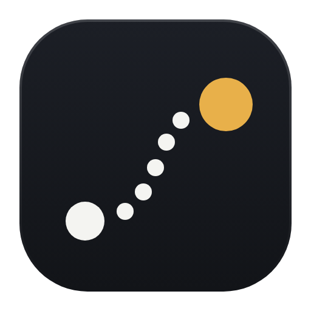
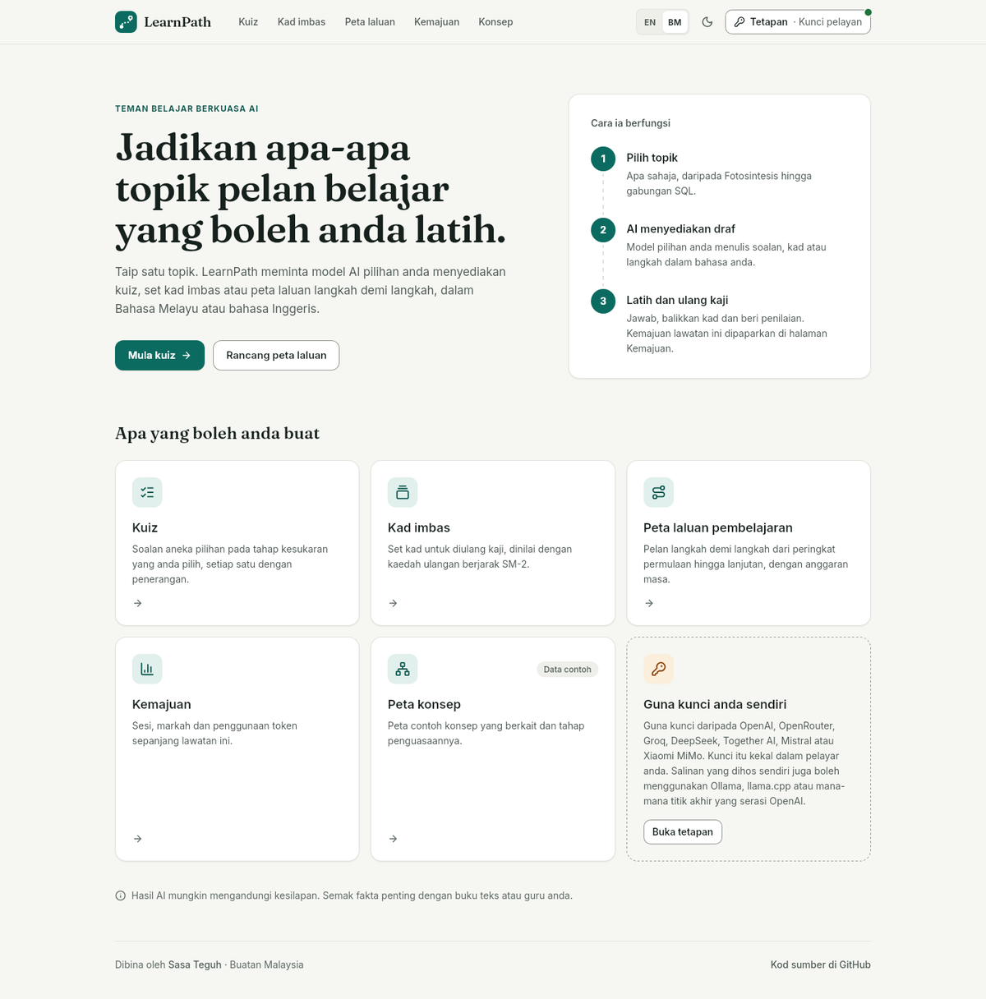
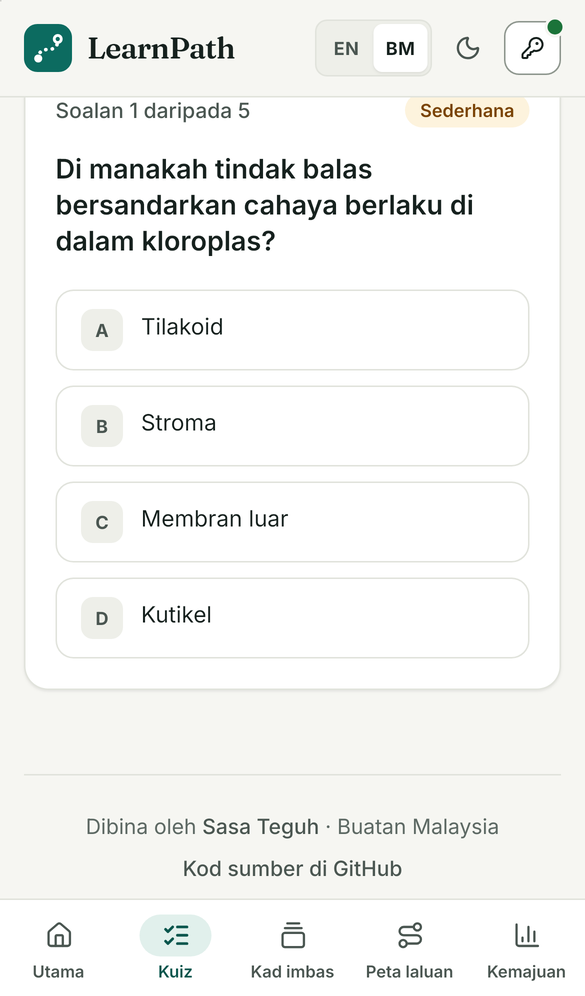
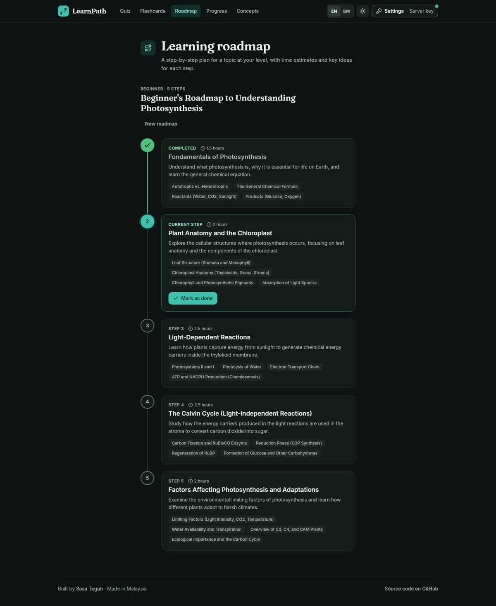
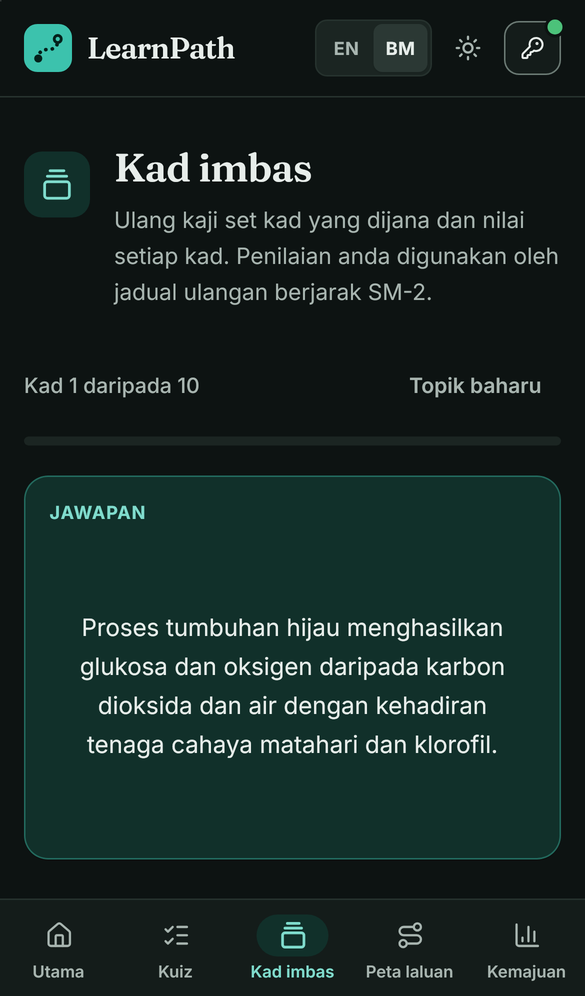

<p align="center"></p>

<h1 align="center">LearnPath</h1>

<p align="center"><a href="https://github.com/aimanmalib/learnpath/actions/workflows/ci.yml"></a> <a href="https://nextjs.org/"></a> <a href="https://www.typescriptlang.org/"></a> <a href="https://github.com/aimanmalib/learnpath/blob/main/LICENSE"></a></p>

<p align="center"><b>Quizzes, flashcards and learning roadmaps from any OpenAI-compatible LLM, in English and Bahasa Melayu.</b> · <i>Kuiz, kad imbas dan peta laluan pembelajaran daripada mana-mana LLM yang serasi OpenAI, dalam bahasa Inggeris dan Bahasa Melayu.</i><br>
<a href="https://learnpath-nine.vercel.app">live demo</a> · Built in Malaysia by <a href="https://aimanmalib.com">Aiman Malib</a></p>

LearnPath generates quizzes, flashcards and learning roadmaps for any topic, with SM-2 spaced repetition and a simple progress view. Every AI feature goes through one provider layer (`src/lib/llm/`) that speaks the OpenAI `/chat/completions` protocol. Choose a built-in provider in the browser and bring your own key, or configure the server once with environment variables when you host it yourself. Every screen is in English or Bahasa Melayu. The [live demo](https://learnpath-nine.vercel.app) uses your own API key: open **Settings**, pick a provider and paste a key; it stays in your browser.

[Bahasa Melayu ↓](#bahasa-melayu)

<table>
  <tr>
    <td width="60%"></td>
    <td width="40%"></td>
  </tr>
  <tr>
    <td></td>
    <td></td>
  </tr>
</table>
<sub>Screenshots taken in Safari/WebKit (desktop and iPhone 13). The quiz, roadmap and flashcard text is real model output.</sub>

## Features

| Feature | What it does |
|---------|--------------|
| **Quiz** | Generates multiple-choice questions for any topic at the difficulty you choose (easy / medium / hard), with an explanation after each answer |
| **Flashcards** | Generates cards for a topic and schedules reviews with the SM-2 spaced-repetition algorithm |
| **Learning Roadmap** | Builds a step-by-step plan for a topic at beginner / intermediate / advanced level |
| **Progress Tracker** | Shows the sessions, scores and token usage from your current visit (kept in memory, not saved) |
| **Concept Map** | A static sample map of connected concepts (not generated by the LLM yet) |
| **Bahasa Melayu + English** | Every screen in BM or English (switch in the top bar). The AI answers in the language you are reading |
| **Light and dark themes** | Follows your device setting; the moon/sun button overrides it |

### Languages

- All UI text lives in `src/i18n/messages/en.ts` and `ms.ts`. A test fails if a key exists in one language but not the other, if placeholders differ, or if the BM file contains common Indonesian words (`karena`, `harus`, `kirim`, ...).
- The first visit uses your browser language (`ms`/`ms-MY` → BM, anything else → English). Your choice is saved in `localStorage` and mirrored to a cookie so the server renders the page in the same language.
- Every API call sends `language: "en" | "ms"`. The server adds an instruction to the prompt to answer in that language; for BM it asks for standard Malaysian spelling (Dewan Bahasa dan Pustaka) and names Indonesian words to avoid. How well the model follows it depends on the model you choose.

There are also two API-only routes with no page yet: `POST /api/chat` (single message, optional streaming) and `POST /api/analyze` (study-session analysis). Both accept the same optional `language` field.

## Bring your own key (how the demo works)

The public demo has no server-side key. Each visitor uses their own:

1. Click **Settings** (the key icon on phones) in the top bar.
2. Pick a provider, keep the suggested model or type another, and paste your API key.
3. Press **Save**. **Forget key** removes it again.

What happens to the key:

- It is stored **only in your browser** (`localStorage`).
- With each request it is sent in an `x-llm-key` header (with `x-llm-provider` and `x-llm-model`) to this app's own API route, which forwards it to the provider you chose.
- The server does **not** store or log it, and error messages never echo the provider's response body.
- The server only forwards to the fixed base URLs of the built-in providers below. Visitors cannot point it at another address.
- `max_tokens` is capped on the server (4096 by default).

Use a key with a spending limit, and press **Forget key** on shared devices.

## Supported providers

| Provider | Id | Base URL | Default model | Auth header |
|----------|----|----------|---------------|-------------|
| OpenAI | `openai` | `https://api.openai.com/v1` | `gpt-4o-mini` | `Authorization: Bearer` |
| OpenRouter | `openrouter` | `https://openrouter.ai/api/v1` | `openai/gpt-4o-mini` | `Authorization: Bearer` |
| Groq | `groq` | `https://api.groq.com/openai/v1` | `llama-3.3-70b-versatile` | `Authorization: Bearer` |
| DeepSeek | `deepseek` | `https://api.deepseek.com/v1` | `deepseek-chat` | `Authorization: Bearer` |
| Together AI | `together` | `https://api.together.xyz/v1` | `meta-llama/Llama-3.3-70B-Instruct-Turbo` | `Authorization: Bearer` |
| Mistral | `mistral` | `https://api.mistral.ai/v1` | `mistral-small-latest` | `Authorization: Bearer` |
| Xiaomi MiMo | `mimo` | `https://api.xiaomimimo.com/v1` | `mimo-v2.5-pro` | `api-key` |
| Xiaomi MiMo (Token Plan, Singapore) | `mimo-token-plan` | `https://token-plan-sgp.xiaomimimo.com/v1` | `mimo-v2.5-pro` | `api-key` |
| Ollama (self-host) | `ollama` | `http://localhost:11434/v1` | `llama3.1` | none / Bearer |
| llama.cpp server (self-host) | `llamacpp` | `http://localhost:8080/v1` | `local-model` | none / Bearer |
| Custom endpoint (self-host) | `custom` | set by you | set by you | Bearer if a key is given |

The model field is free text, so any model your provider offers works. Self-host entries can only be chosen in the browser when the server sets `LLM_ALLOW_CUSTOM_BASE_URL=1`; they are always available through `LLM_PROVIDER`.

## Self-hosting

```bash
git clone https://github.com/aimanmalib/learnpath.git
cd learnpath
npm install
npm run dev          # http://localhost:3000
```

Without any environment variables the app runs in bring-your-own-key mode, like the demo. To give every visitor of your copy a shared server key, create `.env.local`:

```bash
LLM_PROVIDER=openai
LLM_API_KEY=your-key-here
```

| Variable | Default | Meaning |
|----------|---------|---------|
| `LLM_PROVIDER` | `openai` | Provider id from the table above |
| `LLM_API_KEY` | (none) | Server key. When set, the server uses it and ignores keys sent by browsers |
| `LLM_MODEL` | preset default | Model name |
| `LLM_BASE_URL` | preset URL | Override the provider URL (required for `custom`) |
| `LLM_ALLOW_CUSTOM_BASE_URL` | off | `1` lets the browser choose Ollama, llama.cpp or a custom base URL. Only enable this on a private deployment: it lets visitors make your server send requests to any address |
| `LLM_MAX_TOKENS` | `4096` | Upper limit for `max_tokens` on every request |

Server mode is active when `LLM_API_KEY` is set, or when `LLM_PROVIDER` is a keyless local server (`ollama`, `llamacpp`, `custom`). Example for a local Ollama:

```bash
LLM_PROVIDER=ollama
LLM_MODEL=llama3.1
# LLM_BASE_URL=http://my-ollama-host:11434/v1
```

`GET /api/llm-config` tells the UI which mode the server is in. It never returns the key.

**Upgrading from 1.0:** the old `MIMO_API_KEY`, `OPENAI_API_KEY`, `*_BASE_URL` and `MIMO_MODEL` variables are no longer read. Use `LLM_API_KEY`, `LLM_BASE_URL` and `LLM_MODEL`.

## Development

Requires Node.js 22.12 or newer.

```bash
npm ci               # install
npm run dev          # http://localhost:3000, then add your key in Settings
npm test             # vitest
npm run typecheck    # tsc --noEmit
npm run lint         # eslint
npm run build        # production build
```

## Architecture

```
Browser (Next.js pages, UI text from src/i18n/messages/{en,ms}.ts)
  │  Settings panel → localStorage (provider, model, key)
  │  fetch /api/* with x-llm-provider / x-llm-model / x-llm-key, body includes language: "en" | "ms"
  ▼
API routes  /api/quiz · /api/flashcards · /api/roadmap · /api/chat · /api/analyze
  │  src/lib/llm/server.ts    resolve: server env key → else request headers → else 400
  │                           allowlist of provider base URLs, max_tokens cap
  │  src/lib/llm/language.ts  "answer in English / Bahasa Melayu (Malaysia)" prompt instruction
  │  src/lib/llm/client.ts    POST {baseUrl}/chat/completions, friendly upstream errors
  ▼
OpenAI-compatible provider (OpenAI, OpenRouter, Groq, DeepSeek, Together, Mistral, MiMo, Ollama, …)
```

## Tech stack

- Next.js 16 (App Router), React 19, TypeScript
- Tailwind CSS 4 with colour tokens (light + dark) in `src/app/globals.css`; a test checks WCAG AA contrast for every text/background pair
- lucide-react icons, Inter + Fraunces (self-hosted by `next/font`)
- Zustand (state)
- SM-2 spaced repetition
- Vitest + Testing Library

## How this was built

learnpath was built with AI coding assistance (Claude Code) under the direction of its author, Muhammad Aiman.

The evidence that it works is meant to be checkable:

- The test suite, run with `npm test`.
- CI on Node 22 and 24 for every pull request.
- A live demo at https://learnpath-nine.vercel.app.

## Security

See [SECURITY.md](https://github.com/aimanmalib/learnpath/blob/main/SECURITY.md) to report a vulnerability privately.

## Bahasa Melayu

LearnPath menjana kuiz, kad imbas dan peta laluan pembelajaran untuk apa-apa topik, dengan ulangan berjarak SM-2 dan paparan kemajuan yang ringkas. Setiap ciri AI melalui satu lapisan penyedia (`src/lib/llm/`) yang memakai protokol `/chat/completions` OpenAI, jadi ia berfungsi dengan mana-mana LLM yang serasi OpenAI. Setiap skrin ada dalam Bahasa Melayu dan bahasa Inggeris (tukar di bar atas), dan AI menjawab dalam bahasa yang sedang anda baca.

**Ciri utama:**
- **Kuiz:** soalan aneka pilihan untuk apa-apa topik pada tahap kesukaran pilihan anda (mudah / sederhana / sukar), dengan penerangan selepas setiap jawapan.
- **Kad imbas:** set kad untuk satu topik, dengan jadual ulang kaji ikut algoritma ulangan berjarak SM-2.
- **Peta laluan pembelajaran:** pelan langkah demi langkah pada peringkat permulaan / pertengahan / lanjutan.
- **Kemajuan:** sesi, markah dan penggunaan token bagi lawatan semasa (dalam memori sahaja, tidak disimpan).
- **Peta konsep:** peta contoh yang statik (belum dijana oleh LLM).
- **Tema cerah dan gelap** ikut tetapan peranti, boleh ditukar dengan butang bulan/matahari.

Semua teks antara muka berada dalam `src/i18n/messages/en.ts` dan `ms.ts`. Ujian gagal jika satu kunci wujud dalam satu bahasa sahaja, jika pemegang tempat berbeza, atau jika fail BM mengandungi perkataan Indonesia yang biasa (`karena`, `harus`, `kirim`, ...). Untuk BM, pelayan meminta model menulis dengan ejaan standard Malaysia (Dewan Bahasa dan Pustaka); hasilnya bergantung pada model yang anda pilih.

**Cara guna demo (kunci API anda sendiri).** Demo awam tiada kunci di pelayan. Buka [demo](https://learnpath-nine.vercel.app), tekan **Tetapan** (ikon kunci pada telefon), pilih penyedia, kekalkan model cadangan atau taip model lain, tampal kunci API dan tekan **Simpan**. Kunci disimpan dalam pelayar anda sahaja (`localStorage`) dan dihantar bersama setiap permintaan ke laluan API aplikasi ini, yang meneruskannya kepada penyedia pilihan anda. Pelayan tidak menyimpan atau melog kunci itu, dan hanya meneruskan ke URL asas penyedia terbina dalam. Guna kunci yang ada had perbelanjaan, dan tekan **Lupakan kunci** pada peranti yang dikongsi.

**Hos sendiri.** Perlu Node.js 22.12 atau lebih baharu.

```bash
git clone https://github.com/aimanmalib/learnpath.git
cd learnpath
npm install
npm run dev          # http://localhost:3000
```

Tanpa pemboleh ubah persekitaran, aplikasi berjalan dalam mod kunci sendiri seperti demo. Untuk memberi satu kunci pelayan kepada semua pelawat salinan anda, cipta `.env.local` dengan `LLM_PROVIDER` dan `LLM_API_KEY`. Senarai penuh pemboleh ubah dan penyedia ada dalam [Self-hosting](#self-hosting) dan [Supported providers](#supported-providers) di atas.

## Licence

[MIT](https://github.com/aimanmalib/learnpath/blob/main/LICENSE) © 2026 Muhammad Aiman

---

Built by [Sasa Teguh](https://sasateguh.com) · Malaysia

## Work with Sasa Teguh

[](https://sasateguh.com/book)

I built this project. I run [Sasa Teguh](https://sasateguh.com), a studio in Malaysia that builds websites found on Google and in AI answers, and sets up systems like this one for businesses.

[Book a call](https://sasateguh.com/book) · hello@sasateguh.com · [More from Sasa Teguh](https://github.com/sasateguh)
